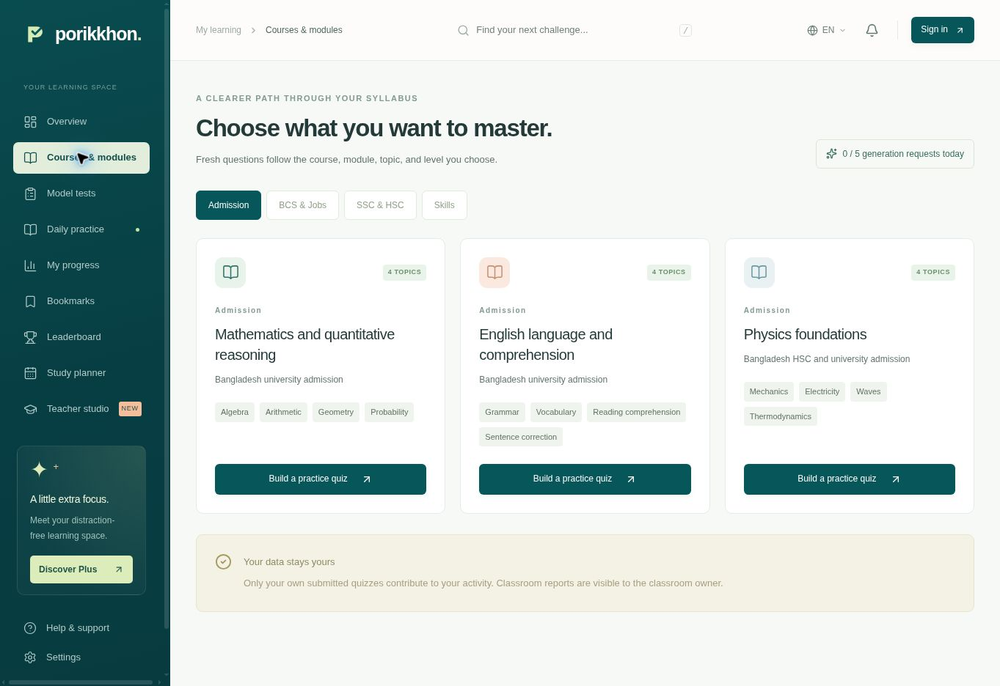

  

  <strong>Practice with purpose. Learn from every attempt.</strong> 
  A calmer exam preparation platform for learners and teachers in Bangladesh.

  <kbd>Next.js 16</kbd> &nbsp; <kbd>TypeScript</kbd> &nbsp; <kbd>Supabase</kbd> &nbsp; <kbd>Gemini + OpenRouter</kbd> &nbsp; <kbd>Vercel</kbd>

  <a href="https://porikkhon-two.vercel.app/">Explore Porikkhon ↗</a> &nbsp; · &nbsp;
  <a href="#quick-start">Quick start</a> &nbsp; · &nbsp;
  <a href="#learning-tracks">Learning tracks</a> &nbsp; · &nbsp;
  <a href="#architecture">Architecture</a> &nbsp; · &nbsp;
  <a href="#launch-status">Launch status</a>

---

## A little practice. A lot more confidence.

Porikkhon brings focused quizzes, timed model tests, useful explanations and a clear view of progress into one learning space. Its deep teal palette, soft contrast and responsive layouts help learners find their next useful step.

| Learning tracks | Practice modules | Starter bank | Review exports |
| :---: | :---: | :---: | :---: |
| **4** | **13** | **60 questions** | **Word + CSV** |

  
   
  Actual deployed interface · course and module selection · 24 October 2026

## Built around the way you learn

| Experience | What it offers |
| :--- | :--- |
| **Focused practice** | Choose a course, module, topic, difficulty and question language. Generated quizzes follow explicit curriculum rules. |
| **Exam practice** | Timed attempts, review flags, negative marking where applicable, saved answers and grading on the server. |
| **Meaningful progress** | Activity over 7, 30 or 90 days, subject accuracy, attempt history and study time from submitted work. |
| **Useful revision** | Bookmarks, explanations, question issue reports and downloadable answer reviews. Word exports include Bengali fonts when needed. |
| **A place to plan** | Personal study tasks and daily goals, alongside an optional public daily sprint ranking. |
| **A teaching space** | Classrooms, join codes, teacher question banks, assigned tests and results visible to the classroom owner. |
| **Account protection** | Email/password accounts, confirmation and recovery routes, plus Google Authenticator-compatible TOTP. Enrolled accounts require a verified second factor for private data. |
| **Room to grow** | Prepaid Plus plan logic and hosted SSLCOMMERZ checkout integration, gated until payment credentials and validation are complete. |

## Learning tracks

| Track | Modules | Focus |
| :--- | :--- | :--- |
| **Admission** | Mathematics, English, Physics foundations | University admission and HSC foundations |
| **BCS & Jobs** | Bangladesh affairs, International affairs, Bangla | Stable general knowledge, language and literature |
| **SSC & HSC** | Physics, Chemistry, Biology, General science | School science, concepts and quantitative reasoning |
| **Skills** | Computing and digital literacy, Logical and numerical reasoning | Programming logic, digital safety and aptitude |
| **Across tracks** | Mixed foundation check | Mathematics, English and science |

Every module defines its level, allowed topics and content rules in [the module catalog](lib/catalog.ts). Bangla language and literature questions use Bengali; other modules offer English or Bengali generation.

## Architecture

~~~mermaid
flowchart TD
    App["Next.js application"] --> Auth["Supabase Auth: password + TOTP"]
    App --> Rules["Module rules and generation settings"]
    Rules --> Gemini["Gemini: draft and review"]
    Gemini -->|"Provider or validation failure"| Backup["OpenRouter: draft and review"]
    Gemini -->|"Validated question snapshot"| DB["Private PostgreSQL and scoped RPC"]
    Backup -->|"Validated question snapshot"| DB
    Auth -->|"Identity and assurance checks"| DB
    App -->|"Answers, deadlines and grading"| DB
    DB --> Results["Activity, explanations and Word / CSV reviews"]
~~~

The database owns saved attempt deadlines and grading. Learners receive question text and options during a test; answer keys and explanations are released through the submitted review. Classroom access is checked against ownership or membership.

### How fresh questions are prepared

1. **Scope the session.** Validate the module, topic, count, difficulty and language, then reserve the generation budget.
2. **Draft and review.** Gemini produces a structured quiz and a separate review pass checks it. OpenRouter is the fallback when a provider attempt fails.
3. **Validate and save.** Check the schema, answer indices, distinct options, duplicates, language and topic allocation before saving the private snapshot.

AI questions can contain errors. Review passes and automatic checks reduce mistakes; learners can report an issue after submission. These are practice materials, not official past questions or certified exam content.

## Quick start

Use **Node.js 24**, npm and a Supabase project. Access to this private repository is required to clone it.

~~~bash
git clone https://github.com/shohidul-code/porikkhon.git
cd porikkhon
npm ci
cp .env.example .env.local
~~~

Fill in <code>.env.local</code>, then apply [the database schema](supabase/schema.sql) to the intended database or use the matching [baseline migration](supabase/migrations/20261024021713_porikkhon_platform.sql) through your migration workflow. Configure Supabase Auth using the launch checklist below.

~~~bash
npm run dev
~~~

The local app runs at <code>http://localhost:3000</code>. The starter bank works without AI credentials; saved accounts and attempts require Supabase.

### Environment configuration

Start from [the environment template](.env.example). Keep real credentials in ignored local files or encrypted hosting variables.

| Variable | Visibility | Purpose |
| :--- | :--- | :--- |
| <code>NEXT_PUBLIC_SUPABASE_URL</code> | Public | Supabase project URL |
| <code>NEXT_PUBLIC_SUPABASE_PUBLISHABLE_KEY</code> | Public | Browser access through the project's scoped permissions |
| <code>NEXT_PUBLIC_APP_URL</code> | Public | Canonical app origin for confirmation, resend and recovery links |
| <code>GEMINI_API_KEY</code> | Server only | Primary question provider |
| <code>OPENROUTER_API_KEY</code> | Server only | Backup question provider |
| <code>GEMINI_MODEL</code>, <code>OPENROUTER_MODEL</code>, <code>OPENROUTER_REVIEW_MODEL</code> | Server only | Optional overrides; defaults are in [the generation service](lib/generation.ts) |
| <code>BILLING_ENABLED</code> | Server only | Defaults to <code>false</code>; billing also requires the credentials below |
| <code>PUBLIC_APP_URL</code> | Server only | HTTPS origin for payment callbacks |
| <code>SSLCOMMERZ_STORE_ID</code>, <code>SSLCOMMERZ_STORE_PASSWORD</code> | Server only | Merchant credentials |
| <code>SSLCOMMERZ_MODE</code> | Server only | <code>sandbox</code> during validation; <code>live</code> for an approved launch |
| <code>SUPABASE_SERVICE_ROLE_KEY</code> | Server only | Privileged payment validation; required only when activating billing |

Never place provider keys, merchant passwords or the service-role key in <code>NEXT_PUBLIC_</code> variables, client code or Git.

## Development and verification

| Command | Purpose |
| :--- | :--- |
| <code>npm run dev</code> | Start the local development server |
| <code>npm run typecheck</code> | Check TypeScript |
| <code>npm test</code> | Run grading, payment rules, module rules and isolated PostgreSQL checks |
| <code>npm run build</code> | Produce the optimized Next.js build |
| <code>npm start</code> | Serve the production build |
| <code>npm run db:new -- migration_name</code> | Create a migration with the Supabase CLI |

<strong>Run an opt-in live generation check</strong>

These checks use real provider quota. Narrow the module list when checking a specific change.

~~~bash
GENERATION_MODULES=admission-math,bcs-bangla node --conditions=react-server --import ./scripts/node-ts-loader.mjs scripts/check-generators.mjs
~~~

The script also exercises the backup provider. Omitting <code>GENERATION_MODULES</code> checks all thirteen modules. Provider failures remain failures; starter questions are not reported as generated questions.

### Last recorded validation · 24 October 2026

| Area | Recorded result |
| :--- | :--- |
| **Automated checks** | 51 passed, including grading, quotas, privacy boundaries, classroom access and MFA assurance enforcement |
| **Build quality** | TypeScript and production build passed |
| **Live endpoints** | Supabase health, grading, anonymous private-action rejection and cross-origin rejection checked |
| **Word export** | Valid document with embedded Bengali fonts; both rendered pages visually inspected |
| **Responsive UI** | Mobile and tablet course views checked without horizontal overflow |
| **Dependency and database review** | Production dependency audit reported zero known vulnerabilities; Supabase security advisor reported no findings at validation time |

Full evidence and limits are in [the validation record](VALIDATION.md). Local database tests use isolated synthetic fixtures, not production authentication users. Email delivery, personal authenticator enrollment and real payments require their own live checks.

## Security by design

- **Private data boundaries.** Private tables use row-level security and explicit deny policies. Scoped functions validate identity, ownership, classroom access and authenticator assurance.
- **Protected requests.** A nonce-based Content Security Policy, secure cookies on HTTPS, same-origin JSON mutations and input limits reduce the attack surface.
- **Server authority.** Saved deadlines, scores, generation budgets, fixed payment amounts and Plus entitlements are controlled on the server or in the database.
- **Careful output handling.** Private responses use <code>no-store</code>; CSV exports protect against formula injection; Word reviews use validated answer records.
- **Minimal provider context.** Generation sends curriculum settings and draft questions, not learner emails or private results. Error logs exclude credentials and request headers.

These are implemented controls, not an independent penetration-test certification.

### Generation budgets

| Scope | Daily generation requests |
| :--- | ---: |
| Free account | 5 |
| Verified Plus account | 20 |
| Entire site | 200 |

Budgets use Bangladesh time. Failed requests count toward the limit to prevent quota-reset abuse. A quiz can require multiple provider calls for drafting, review and fallback; provider quotas apply independently.

## Launch status

The application is deployed at **[porikkhon-two.vercel.app](https://porikkhon-two.vercel.app/)**. These operational requirements remained open in the last recorded validation on **24 October 2026**.

| Area | What remains |
| :--- | :--- |
| **Fresh AI generation** | Restore provider quota or configure an available compatible model. The final live run received Gemini <code>429</code> / <code>503</code> and OpenRouter <code>429</code> responses. Starter practice remains available. |
| **Public accounts** | Production Site URL and exact callbacks are configured. Configure production SMTP and server password policy, then finish real-account recovery and authenticator checks. |
| **Payments** | Supply merchant and privileged server credentials, finish sandbox validation and explicitly activate billing. Checkout is disabled. |
| **Custom domain** | Apply Vercel ownership and routing records for <code>porikkhon.com</code>, then verify DNS and HTTPS. |

<strong>Authentication checklist</strong>

1. Set the Supabase Site URL to the actual HTTPS production origin.
2. Allow the production <code>/auth/callback</code> URL and the intended local callback URL. Keep production redirects specific.
3. Connect a verified production SMTP sender. Supabase's default sender is limited to authorized project-team addresses.
4. Keep email confirmation enabled; configure a server password policy of at least 12 characters, secure email changes and authentication rate limits.
5. Enable TOTP enrollment and verification for Google Authenticator and compatible apps.
6. Check the email templates: <code>/auth/confirm</code> accepts token hashes, <code>/auth/callback</code> accepts PKCE codes, and recovery must retain <code>next=reset</code>.
7. Verify confirmation, login, recovery, enrollment, wrong-code rejection, sign-out and a fresh second-factor challenge with an authorized real account.

<strong>Payments and Plus</strong>

The configured launch prices are **৳199 for 30 days** and **৳1,799 for 365 days**. Plans are prepaid with no automatic renewal. Plus access begins only after payment validation.

Activation requires <code>BILLING_ENABLED=true</code>, merchant credentials, <code>SSLCOMMERZ_MODE</code>, <code>PUBLIC_APP_URL</code> and a server-only Supabase service-role key. In the sandbox, validate success, failure, cancellation, exact amount and currency, risk review and duplicate callbacks before live payments. No real charge was performed during recorded checks.

Commercial launch also needs real support, billing terms, refund handling, data retention and incident response processes.

<strong>Custom domain records</strong>

Vercel returned these records for <code>porikkhon.com</code> on **24 October 2026**. Confirm them in the Vercel project before applying later changes.

| Type | Host | Value |
| :--- | :--- | :--- |
| <code>A</code> | <code>@</code> | <code>76.76.21.21</code> |
| <code>TXT</code> | <code>_vercel</code> | <code>vc-domain-verify=porikkhon.com,5c2b56b78b6efa5241fe</code> |

Replace the existing apex parking A record and preserve mail and unrelated records. Domain verification is pending. Earlier Sites DNS instructions belong to the previous deployment and should not be reused for Vercel.

## Find your way around the code

| Location | Responsibility |
| :--- | :--- |
| [Learning application](app/Porikkhon.tsx) | Dashboard, test runner and submitted reviews |
| [Components](components/) | Course builder, activity chart and authentication UI |
| [API routes](app/api/) | Exam, review, health and payment endpoints |
| [Auth callbacks](app/auth/) | Confirmation and recovery |
| [Module catalog](lib/catalog.ts) | Course definitions, allowed topics and curriculum rules |
| [Generation](lib/generation.ts) · [Question rules](lib/question-rules.mjs) | Providers, review pass and validation |
| [Word exporter](lib/review-document.ts) | Answer documents and Bengali font embedding |
| [Supabase](supabase/) | Database schema and baseline migration |
| [Tests](tests/) | Rules and isolated PostgreSQL workflow checks |
| [Validation record](VALIDATION.md) | Recorded evidence and limits |

The original private Sites deployment is preserved separately. Its ChatGPT identity records are not automatically assigned to new Supabase accounts. Deployment linkage and credentials stay outside Git.

---

  <strong>Porikkhon · Your next step, prepared.</strong> 
  English and বাংলা · Built for focused practice and thoughtful teaching 
  Bengali font: Noto Sans Bengali, distributed with its <a href="public/fonts/OFL-NotoSansBengali.txt">SIL Open Font License</a>.

### Email confirmation redirects

The live Supabase Site URL is `https://porikkhon-two.vercel.app`, with exact allowed callbacks at `/auth/callback`, `/auth/callback?next=reset` and `/auth/confirm`. Keep `NEXT_PUBLIC_APP_URL` and server `PUBLIC_APP_URL` aligned with that origin. Production email links reject localhost origins.

If an email link opens in another browser without the original PKCE verifier, Porikkhon offers email/password sign-in rather than claiming that the link expired or that confirmation succeeded. Expired links offer a resend option. Password recovery still requires a valid session and a browser-bound reset flow; a missing verifier never permits changing a password.
